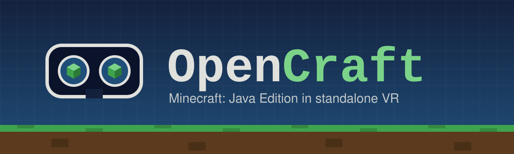

# OpenCraft



OpenCraft runs Java Edition directly on standalone VR headsets like the Meta Quest. You don't need a PC or streaming. The game runs on the headset, and you play it in roomscale VR with your controllers.

This repository contains everything needed to build the headset app from source.

> OpenCraft is an independent community project. It isn't affiliated with or endorsed by Mojang Studios or Microsoft. It doesn't include the game. You sign in with your own Microsoft account, and the game files download from Mojang's servers.

## What's in it

- A launcher app that runs on the headset. It handles sign-in, versions and mods.
- The game itself, running in VR through the Vivecraft mod.
- Game versions 1.19.2, 1.19.4, 1.20.1, 1.20.4, 1.20.6, 1.21.1 and 1.21.4.
- Multiplayer on regular servers.

Support for 26.x versions is being worked on in a separate branch.

## Putting it on your headset

You'll need:
- a headset with developer mode turned on
- [SideQuest](https://sidequestvr.com/setup-howto) on your computer
- an account that owns Java Edition
- an internet connection the first time you launch each version

Then:

1. Get an APK. Build one yourself (see below), or download one from [Releases](https://github.com/Tennessene/OpenCraft/releases) once one is posted.
2. Plug in the headset, open SideQuest, and drop the APK onto it.
3. On the headset, open your app library, switch the filter to **Unknown Sources** and start OpenCraft.
4. Sign in, pick a version and press **Play**. The first start of each version downloads a lot of files, so leave the headset on until it finishes.

The app still uses the package name `com.qcxr.qcxr`. If another app with that package name is already installed, uninstall it first. Uninstalling it also removes that app's saved worlds, so copy them off the headset beforehand.

## Building from source

| Folder | Contents |
|---|---|
| `wrapper/` | The Unity project for the headset app. Building it gives you the APK. |
| `pojlib/` | The Android library that downloads the game, Java and mods and starts the game. |

```bash
git clone --recurse-submodules https://github.com/Tennessene/OpenCraft.git
cd OpenCraft
./scripts/setup.sh
./scripts/build-pojlib.sh
./scripts/build-apk.sh
```

[BUILDING.md](BUILDING.md) lists the tools you need and what to expect.

## Controls

| Controller | Input | Action |
|---|---|---|
| Left | Thumbstick | Walk; click to sprint |
| Left | Trigger | Use item / place block |
| Left | Grip | Previous hotbar slot |
| Left | X | Open inventory |
| Left | Y | Teleport |
| Left | Menu | Pause menu |
| Right | Thumbstick | Turn; click to sneak |
| Right | Trigger | Attack / break block |
| Right | Grip | Next hotbar slot |
| Right | A | Radial menu |
| Right | B | Jump |

## When something breaks

If the game crashes while loading, a mod is the most common cause. The launcher's **Need Help?** button gives you a link to your log. You can also find `latestlog.txt` in the app's folder under `Android/data`. The last error near the bottom of the log usually names the mod involved.

For bugs in OpenCraft itself, [open an issue](https://github.com/Tennessene/OpenCraft/issues).

## Licenses

OpenCraft is made of several open-source projects, and each keeps its own license. [THIRD_PARTY_NOTICES.md](THIRD_PARTY_NOTICES.md) lists them all with their licenses and sources.
